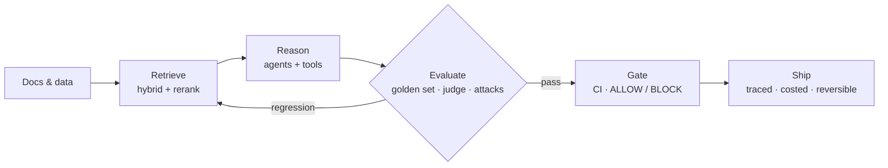

<p align="center">
  
</p>

<p align="center">
  <a href="https://linkedin.com/in/aymen-rahmanii"></a>
  <a href="mailto:aymenrahmeni4@gmail.com"></a>
  
  
</p>

<p align="center"><i>Final-year engineering student at ESPRIT (Software &amp; Data Science). I build LLM systems the way I'd want to review them:<br/>every claim comes with a number, and every number comes with a test.</i></p>

---

### 🔍 Release assessment of this profile

```diff
$ release-gate assess --candidate aymen-rahmani --target pfe-2027

+ retrieval       Recall@5 0.73 to 0.94 after retrieval tuning     (Azure_RAG, 40+ eval runs)
+ answer quality  0.93 correctness vs 0.81 baseline, 60 questions  (Azure_RAG, agentic RAG)
+ safety          0 of 240 prompt-injection attacks succeeded      (Azure_RAG)
+ regression      CI eval gate blocks any PR that lowers quality   (Azure_RAG, FuelCell-RAG)
+ grounding       0 invalid citations, 7/7 correct refusals        (FuelCell-RAG, DE/EN)
- open item       faithfulness 0.87 vs 0.90 target, calibrating    (FuelCell-RAG)

  verdict: ALLOW | available February 2027 | 4-6 months
```

<sub>Yes, the red line stays in. A gate that never says no isn't a gate.</sub>

---

### 🧪 Selected work

| | Project | What it proves |
|:-:|---|---|
| ☁️ | **[Azure_RAG](https://github.com/Aymenrahmanii/Azure_RAG)**<br/><sub>EU regulatory assistant · GDPR, AI Act, NIS2, DORA</sub> | Hybrid RAG, GraphRAG and agentic RAG behind one streaming API on Azure, deployed with Terraform and GitHub Actions; versioned eval harness, CI eval gate, PII masking, OpenTelemetry tracing, 139 tests |
| 📚 | **[FuelCell-RAG](https://github.com/Aymenrahmanii/FuelCell-RAG)**<br/><sub>bilingual technical-document RAG · in progress</sub> | German/English retrieval over datasheets, requirement specs and STEP files; every answer cites a page, table cell, requirement ID or CAD part; Recall@5 0.925 on a 60-question golden set |
| 🌊 | **[CrisisLink-5DS](https://github.com/Aymenrahmanii/CrisisLink-5DS)**<br/><sub>multimodal flood triage · team of 6</sub> | Telegram bot (photo, voice in Derja/French/English, GPS) on n8n; vision and distress agents, a P1–P4 triage agent I own, multilingual RAG on Qdrant, deterministic safety guardrail, human escalation |
| 🛡️ | **[Security & Quality release gate](https://github.com/Aymenrahmanii/Fraud_Detection_MLOps/tree/main/agent3_security_quality)**<br/><sub>my agent in a 6-agent DevOps/MLOps platform</sub> | Tests, coverage, lint, CVEs (Trivy), secrets (Gitleaks) and SonarQube merged into one ALLOW / WARN / BLOCK verdict, wired into CI and exposed as an MCP server |

---

### 🔁 How I build



---

### 🧰 Toolbox

<p>
  
</p>

**LLM & agents:** LangChain · LangGraph · MCP · hybrid RAG · GraphRAG · agentic RAG · tool calling · n8n · Ollama<br/>
**Eval & safety:** Recall@k · MRR · faithfulness · LLM-as-a-judge · prompt-injection testing · PII masking · guardrails<br/>
**Data & ops:** Qdrant · ChromaDB · Azure AI Search · OpenTelemetry · Langfuse · MLflow · Kafka

---

### 🌍 Languages

Arabic (native) · English (C1, certified) · French (B2) · German (B1–B2, TestDaF)

<p align="center"><sub>Currently: finishing FuelCell-RAG's faithfulness calibration · open to a PFE internship in Europe from February 2027</sub></p>
